How to read the city

- **One building per hour of the day.** Its height is the number of commits I have made in that hour, all time.
- **Floors are stacked by year**, oldest at the bottom: brick, then concrete, then glass. The tallest tower is still under construction.
- **Window colours are languages** used in that year.
- **The sky is today's**: sunrise, sunset, the forecast hour by hour, and the phase of the moon.

Redrawn every morning by [a small script](city/) and GitHub Actions.

